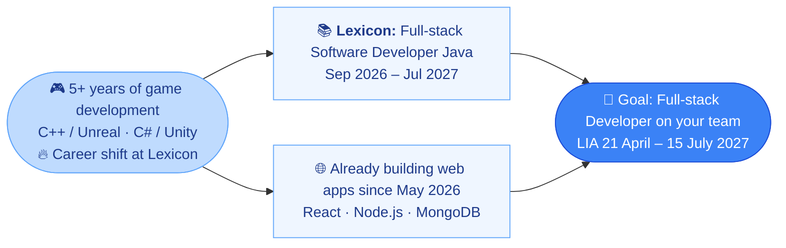

# 💫 Hi, I'm Isa 👋

<!-- Links -->
🔗 [Portfolio](https://IsaVII.github.io/portfolio-software) · [LinkedIn](https://linkedin.com/in/isa-hellstrom/)

🤝 **Looking for a LIA (internship) as a full-stack developer, 21 April – 15 July 2027.**

💡 Software developer with 5+ years in game systems programming — Unreal Engine (C++) and Unity (C#) — including production work at **Studio Northshade** and **Glimeria Studios**.

🌐 Now building full-stack web apps with React, Node.js and MongoDB.
 
💭 Learning: Learning Java and Spring Boot in Lexicon’s Full-stack Software Developer Java program.

> [!NOTE]
> Most of my game work lives in Perforce and Azure repos, so it isn't reflected in the contribution graph. This profile focuses on full-stack and not game-related projects. See my [portfolio](https://IsaVII.github.io/portfolio-software) for the game side.

<!-- Stats + Streak -->

  
  

## 🛠️ Languages & Tools

| Category | Stack |
|:---|:---|
| **Languages** |         |
| **Web** |     |
| **Databases** |   |
| **Tools** |     |
| **Game Engines** |   |

## 🚀 Featured work (Games)
<table align="center">
  <tr>
    <td align="center" width="50%">
       
      <b>Hexavale</b> 
      Hex-based strategy-puzzle game · Unreal Engine · Coming to Early Access (demo out)
    </td>
    <td align="center" width="50%">
       
      <b>Magical Harvest</b> 
      Magical farming RPG · Unreal Engine · Demo out
    </td>
  </tr>
</table>

## 🧭 My path to full-stack

